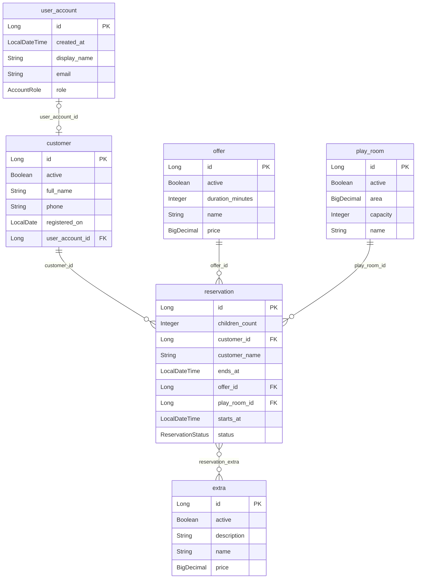

# Schemat bazy danych

Plik generują reguły projektu (panel Maven → Lifecycle → verify). Nie edytujcie go ręcznie.

Tabele: 7 (w tym tabele łączące @ManyToMany: reservation_extra) · kolumny: 35 · relacje: 3 × @ManyToOne, 1 × @OneToMany, 1 × @OneToOne, 1 × @ManyToMany

| Tabela | Encja | Kolumny | Klucze obce |
|---|---|---|---|
| customer | Customer | 6 | user_account_id |
| extra | Extra | 5 | — |
| offer | Offer | 5 | — |
| play_room | PlayRoom | 5 | — |
| reservation | Reservation | 9 | customer_id, offer_id, play_room_id |
| user_account | UserAccount | 5 | — |

